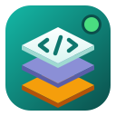

<p align="center"></p>

<h1 align="center">Panel DDEV</h1>

<p align="center">
Tu entorno de desarrollo web local en Linux, desde una ventana.<br>
Crea, clona y gestiona proyectos PHP, Laravel, WordPress y más — con <a href="https://ddev.com">DDEV</a> por debajo.
</p>

<p align="center"><a href="README.md">Read in English</a></p>

---

Si vienes de **Laragon** en Windows, esto es lo más parecido en Linux: cada
proyecto con su dominio (`https://mi-app.local`), su versión de PHP y de Node,
Apache o nginx, MariaDB/MySQL/PostgreSQL, phpMyAdmin, Mailpit y git integrado.
Gratis y de código abierto. En **español e inglés**, con tema **claro y oscuro**.

## Instalación

En **Linux Mint 22 / Ubuntu 24.04** (o derivados de Ubuntu/Debian), abre una terminal y ejecuta:

```bash
curl -fsSL https://raw.githubusercontent.com/jaayala03/panel-ddev/main/install.sh | bash
```

El instalador deja todo listo: **Docker**, **DDEV**, certificados HTTPS locales
(**mkcert**) y **Panel DDEV**. Te pedirá tu contraseña de `sudo`.

Al terminar:

1. **Cierra sesión y vuelve a entrar** (para usar Docker sin `sudo`).
2. **Reinicia el navegador** (para que acepte los certificados HTTPS).
3. Abre **Panel DDEV** desde el menú de aplicaciones.

<details>
<summary>Instalación manual (solo el paquete)</summary>

Si ya tienes Docker y DDEV, descarga el `.deb` de la
[última versión](https://github.com/jaayala03/panel-ddev/releases/latest) e instálalo:

```bash
sudo apt install ./panel-ddev_*_all.deb
```
</details>

<details>
<summary>Desde el código fuente</summary>

```bash
git clone https://github.com/jaayala03/panel-ddev.git
cd panel-ddev
./panel-ddev                # ejecutar sin instalar
./install.sh --local        # o construir e instalar el paquete
```
</details>

### Desinstalar

```bash
sudo apt remove panel-ddev
```

(Docker, DDEV y tus proyectos no se tocan.)

## Qué puedes hacer

- **Proyectos**: lista con su estado; iniciar, detener, reiniciar, apagar todo;
  abrir en el navegador, la carpeta o tu editor.
- **Icono en la bandeja**: arranca o para proyectos y abre sus webs sin abrir la
  ventana; opcionalmente se abre al iniciar sesión.
- **Nuevo proyecto**: tipo (PHP, Laravel, WordPress, Symfony, Drupal, CodeIgniter,
  CakePHP, Craft CMS, Magento), versión de PHP y Node, Apache o nginx, base de
  datos. Puede descargar el framework automáticamente.
- **Clonar con git**: pega una URL o elige uno de **tus repositorios de GitHub** (con buscador); elige la rama; configura DDEV, arranca e instala dependencias
  (`composer install`, `npm install`, `.env` y `APP_KEY` en Laravel).
- **Añadir carpeta**: usa código que ya tienes; detecta el framework y la
  carpeta pública automáticamente.
- **Xdebug**: actívalo o desactívalo con un interruptor.
- **Compartir** un proyecto con un enlace público temporal (túnel de Cloudflare).
- **Editor de .env** con colores, copia de seguridad y «crear desde .env.example».
- **Cambiar configuración** de un proyecto existente (incluye migrar MariaDB ↔ MySQL).
- **Vite**: un clic para que `npm run dev` y la recarga en caliente funcionen con DDEV.
- **Comandos rápidos**: atajos del framework (artisan, wp-cli, drush…), los
  scripts de tu `package.json` y tus propios comandos guardados por proyecto.
- **Herramientas**: terminal dentro del contenedor, logs en vivo, phpMyAdmin,
  Mailpit, importar/exportar la base de datos y **copias** (guardar y restaurar
  copias completas de la base de datos).
- **Git**: cambios con casillas para prepararlos, diferencias con colores,
  historial, commit (Ctrl+Enter), ramas, fetch, pull (fast-forward, merge o
  rebase) y push, descartar cambios, stash y resolución de conflictos.
- **Uso de recursos** (CPU y RAM por proyecto) y **apagado automático** opcional
  de los proyectos sin uso para ahorrar memoria.
- **Avisos de escritorio** cuando terminan las acciones largas, aunque la ventana esté oculta.
- **Preferencias**: español o inglés, tema claro, oscuro o el del sistema, avisos.

Cada acción se ejecuta en una **terminal integrada**: ves exactamente qué
comandos se lanzan, y si algo pide contraseña la escribes ahí mismo.

## Requisitos

- Linux con `apt` (probado en Linux Mint 22.3 y Ubuntu 24.04).
- 4 GB de RAM como mínimo (8 GB recomendado).
- Conexión a internet la primera vez (imágenes de Docker, ~3 GB).

## Licencia y términos

- Código bajo licencia [MIT](LICENSE).
- [Términos de uso y privacidad](TERMINOS.md): sin garantía; la app no recopila datos.
- Panel DDEV es un proyecto **independiente**, no afiliado al proyecto
  [DDEV](https://github.com/ddev/ddev) ni a Docker. Sus nombres son marcas de sus titulares.

La documentación para desarrolladores está en el [README en inglés](README.md#for-developers).
