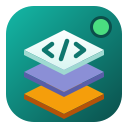

<p align="center"></p>

<h1 align="center">Panel DDEV</h1>

<p align="center">
Your local web development environment on Linux, from one window.<br>
Create, clone and manage PHP, Laravel, WordPress and other projects — powered by <a href="https://ddev.com">DDEV</a>.
</p>

<p align="center"><a href="README.es.md">Leer en español</a></p>

---

Coming from **Laragon** on Windows? This is the closest thing on Linux: every
project gets its own domain (`https://my-app.local`), its own PHP and Node
version, Apache or nginx, MariaDB/MySQL/PostgreSQL, phpMyAdmin, Mailpit and
built-in git. Free and open source. Available in **English and Spanish**, with
**light and dark** themes.

## Install

On **Linux Mint 22 / Ubuntu 24.04** (or other Ubuntu/Debian derivatives), open a terminal and run:

```bash
curl -fsSL https://raw.githubusercontent.com/jaayala03/panel-ddev/main/install.sh | bash
```

The installer sets up **Docker**, **DDEV**, local HTTPS certificates
(**mkcert**) and **Panel DDEV**. It asks for your `sudo` password.

When it finishes:

1. **Log out and back in** (to use Docker without `sudo`).
2. **Restart your browser** (so it trusts the local HTTPS certificates).
3. Open **Panel DDEV** from the applications menu.

<details>
<summary>Manual install (package only)</summary>

If you already have Docker and DDEV, download the `.deb` from the
[latest release](https://github.com/jaayala03/panel-ddev/releases/latest) and install it:

```bash
sudo apt install ./panel-ddev_*_all.deb
```
</details>

<details>
<summary>From source</summary>

```bash
git clone https://github.com/jaayala03/panel-ddev.git
cd panel-ddev
./panel-ddev                # run without installing
./install.sh --local        # or build and install the package
```
</details>

### Uninstall

```bash
sudo apt remove panel-ddev
```

(Docker, DDEV and your projects are left untouched.)

## Features

- **Projects**: list with status; start, stop, restart, stop all; open in the
  browser, the folder or your editor.
- **Tray icon**: start/stop projects and open their sites without the window;
  optional start at login.
- **New project**: type (PHP, Laravel, WordPress, Symfony, Drupal, CodeIgniter,
  CakePHP, Craft CMS, Magento), PHP and Node version, Apache or nginx,
  database. It can download the framework for you.
- **Clone with git**: paste a URL or pick one of **your GitHub repositories** (search included); choose the branch; configures DDEV, starts the project and
  installs dependencies (`composer install`, `npm install`, `.env` and
  `APP_KEY` for Laravel).
- **Add folder**: use code you already have; the framework and public folder
  are detected automatically.
- **Xdebug** on/off with a switch.
- **Share** a project with a temporary public link (Cloudflare quick tunnel).
- **.env editor** with highlighting, backup and "create from .env.example".
- **Change settings** of an existing project (including MariaDB ↔ MySQL migration).
- **Quick commands**: framework shortcuts (artisan, wp-cli, drush…), your
  `package.json` scripts and your own saved commands per project.
- **Tools**: shell inside the container, live logs, phpMyAdmin, Mailpit,
  database import/export and **snapshots** (save and restore copies of the database).
- **Git**: changes with checkboxes to stage them, coloured diffs, history,
  commit (Ctrl+Enter), branches, fetch, pull (fast-forward, merge or rebase) and
  push, discard changes, stash, and conflict resolution (ours / theirs).
- **Notifications** when long actions finish, even with the window hidden.
- **Preferences**: English or Spanish, light, dark or system theme, notifications.

Every action runs in an **embedded terminal**: you see exactly which commands
run, and if something asks for a password you type it right there.

## Requirements

- Linux with `apt` (tested on Linux Mint 22.3 and Ubuntu 24.04).
- 4 GB of RAM minimum (8 GB recommended).
- Internet connection the first time (Docker images, ~3 GB).

## For developers

| File | Purpose |
|---|---|
| `panel_ddev/app.py` | Main window and application |
| `panel_ddev/ddev.py` | Talks to `ddev` and builds the script of each action |
| `panel_ddev/dialogs.py` | New / clone / settings and preferences dialogs |
| `panel_ddev/git.py` | Git tab |
| `panel_ddev/tray.py` | Tray icon |
| `panel_ddev/notify.py` | Desktop notifications |
| `panel_ddev/share.py` | Share a project (ddev share) |
| `panel_ddev/envedit.py` | .env editor |
| `panel_ddev/snapshots.py` | Database snapshots dialog |
| `panel_ddev/commands.py` | Quick commands per framework, npm scripts and saved commands |
| `panel_ddev/github.py` | GitHub repository picker (uses `gh`) |
| `panel_ddev/terminal.py` | Embedded terminal (VTE) |
| `panel_ddev/i18n.py`, `locale_es.py` | Translations |
| `panel_ddev/settings.py` | Preferences and theme |
| `packaging/build-deb.sh` | Builds the `.deb` into `dist/` |
| `packaging/check_translations.py` | Fails if a UI string has no translation |
| `packaging/test_scripts.py` | Smoke tests for the generated bash scripts |
| `packaging/release.sh` | Publishes a GitHub release with the `.deb` |
| `install.sh` | Full installer |

Built with Python 3 and GTK 3 (PyGObject). Code, comments and commits are in
English. UI strings are written in English and wrapped in `_()`; add the Spanish
text to `panel_ddev/locale_es.py`.

To publish a release: bump `__version__` in `panel_ddev/__init__.py`, add the
entry to `CHANGELOG.md`, commit and push, then run `packaging/release.sh` (builds
the `.deb`, tags the version and creates the GitHub release with the changelog
notes).

## License and terms

- Code under the [MIT](LICENSE) license.
- [Terms of use and privacy](TERMS.md): no warranty; the app collects no data.
- Panel DDEV is an **independent** project, not affiliated with the
  [DDEV](https://github.com/ddev/ddev) project or Docker. Their names are
  trademarks of their owners.
